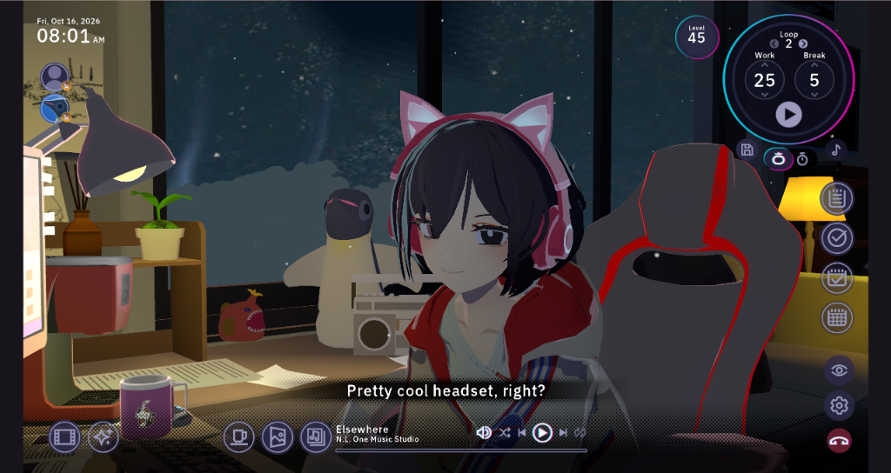
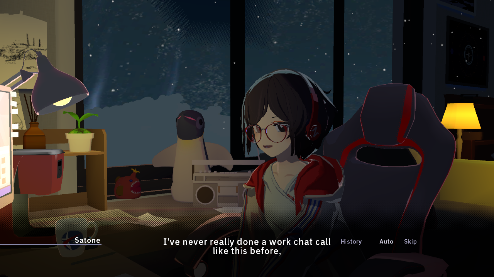
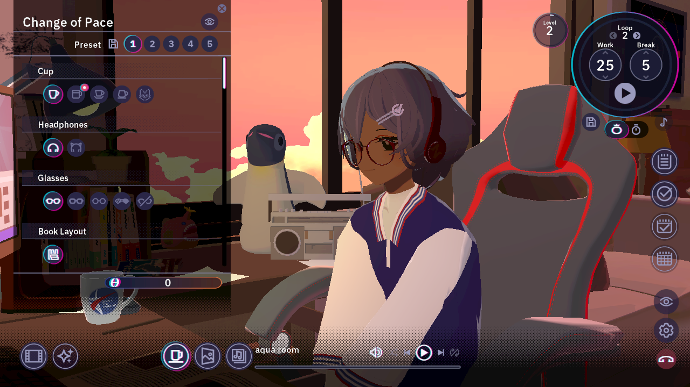
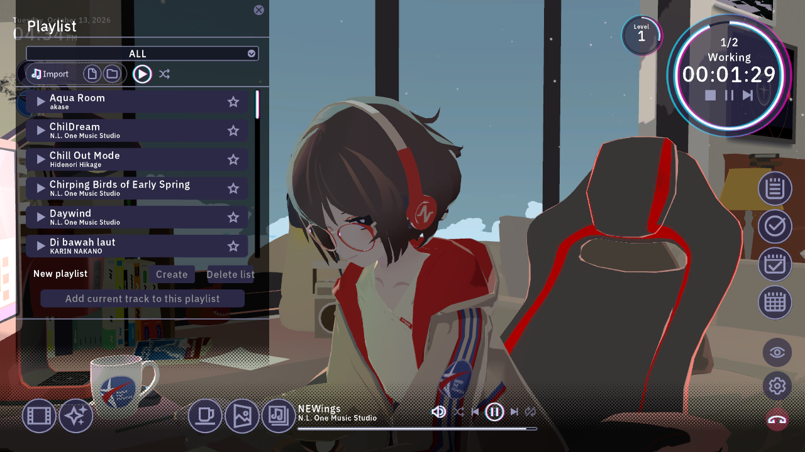
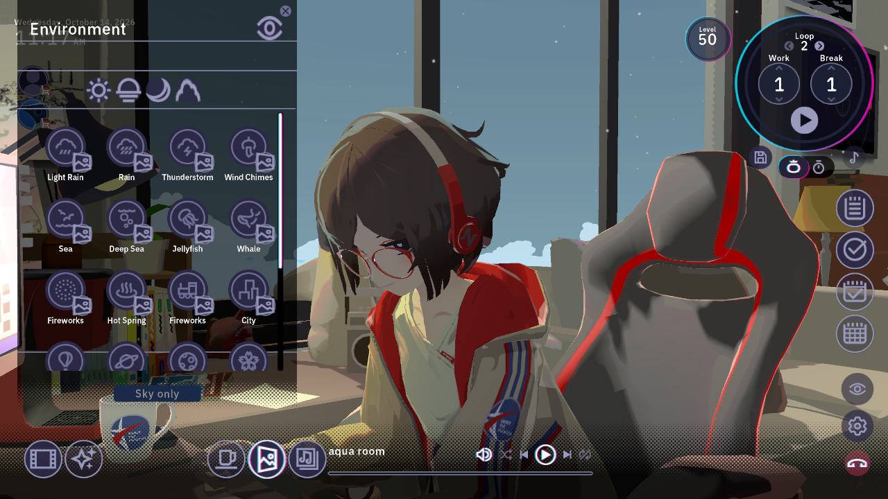
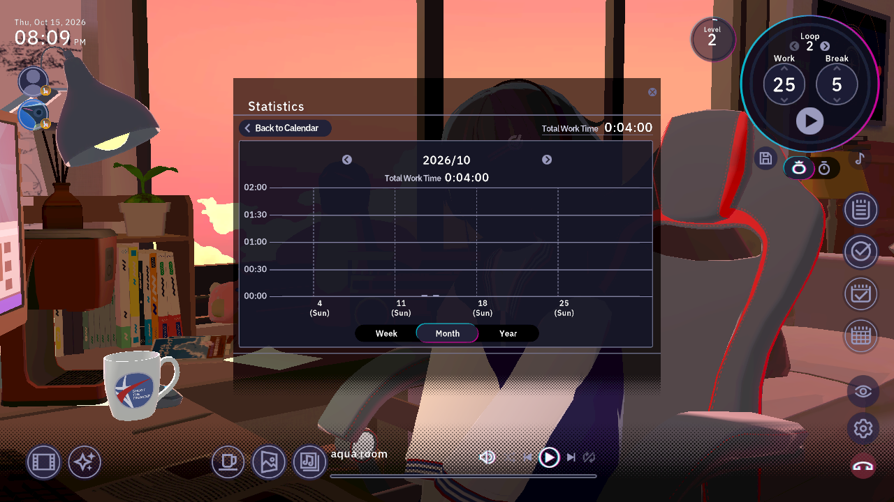
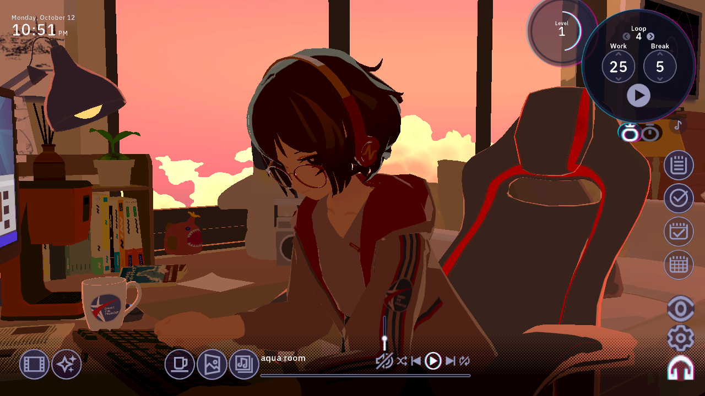
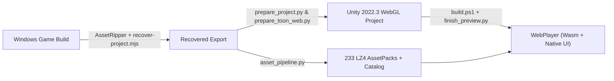

# Chill with You : Lo-Fi Story — WebGL / WebAssembly Port



A standalone **Unity WebGL (WebAssembly)** port of **Chill with You: Lo-Fi Story**, bringing Satone's 3D room, interactive story chapters, Lo-Fi music player, ambient sound mixer, and productivity tools directly into the browser.

---

## 📸 Development & Gameplay Showcase

| Story & Voice Presentation | Decorations, Outfits & Skin Selector |
| :---: | :---: |
|  |  |
| *Night lighting preset, lip-sync, multi-language subtitles & talk log* | *Real-time mesh/material swapping, hair pins, glasses & outfits* |

| Lo-Fi Music Playlists & Pomodoro Timer | Environment & Ambient Sound Mixer |
| :---: | :---: |
|  |  |
| *152 Lo-Fi tracks, custom playlists, local audio import & Pomodoro loop* | *Time-of-day lightmap switching, weather presets & 30-channel ambient mixer* |

| Work Statistics, Calendar & Diary | Sunset Room & Native uGUI Controls |
| :---: | :---: |
|  |  |
| *Weekly/Monthly/Yearly focus bar graphs, habit tracker, to-do lists & diary* | *Restored original scene hierarchy, spring-bone physics & native uGUI* |

---

## ✨ Features

- **Restored 3D Room & Character Rendering**
  - Original room geometry with unbatched static meshes (`CompactSubmeshes`) and baked day/sunset/night/cloudy lightmap switching.
  - Custom **lilToon WebGL2 (Shader Model 3.5)** pipeline (`src/graphics/prepare_toon_web.py`) with spring-bone hair/cloth physics (`ChillBonePhysics`) and WebGL context-loss recovery.
- **Full Story & Autonomous Heroine System**
  - Main episodes, special chapters, daily greetings, autonomous work/break behaviors, snack/drink animations, lip-sync, eye gaze, and multi-language localization (`Ja`, `En`, `ZhHans`, `ZhHant`, `Ko`, `Pt`, `Ru`).
- **Music Player & 30-Channel Ambient Soundscape**
  - 152 built-in Lo-Fi tracks, favorites, custom playlist management, shuffle/repeat modes, and local audio file/folder import (`ChillPersonalMusic`).
  - Independent ambient sound channels (rain, thunderstorm, wind chimes, sea, campfire, café, keyboard/pen sounds, etc.).
- **Focus & Productivity Suite**
  - **Pomodoro & Count-up Stopwatch** with customizable work/break intervals, loops, presets, and timer sound cues.
  - **To-Do Lists, Habit Tracker, Notes/Memos, Calendar & Diary**, and **Work Statistics** (`Week` / `Month` / `Year` bar charts).
- **Room Customization & Wardrobe**
  - 12 furniture/prop decoration categories with skin selector popovers, 5 room layout presets, hair styles, glasses, hats, and outfits.
- **3-Tier Startup Asset Preloader & Browser `CacheStorage`**
  - Interactive startup mode selector on the loading screen:
    - **Tier 1 (~142 MB — Recommended):** Preloads and pins all 50 core visual/mesh/material/texture/animation/SFX packs in RAM for 0ms instant decoration and outfit switching.
    - **Tier 2 (~217 MB):** Includes Tier 1 + all 22 voice-over packs (1,381 voice clips).
    - **Tier 3 (~454 MB — Full Offline):** Preloads all 233 asset packs including all 152 Lo-Fi music tracks into persistent browser `CacheStorage` (`chill-assetpacks-v1`).
    - **Quick Launch (Live Stream):** Enters the room immediately and caches packs on demand.
- **Save System & Developer Debug Menu**
  - Persistent browser storage (IndexedDB + `localStorage` fallback), JSON backup import/export, and native Windows save folder/ZIP import (`src/gameplay-ui/pc-save.mjs`).
  - Built-in **Developer Debug Menu** (press **`F2` twice** in-game) for inspecting FPS, unlocking shop/preview items, triggering any story scenario or heroine animation, testing camera/lighting presets, and switching asset preload tiers.

---

## 🛠️ Architecture & Porting Pipeline



1. **Scene & Shader Reconstruction (`src/graphics/prepare_project.py`, `prepare_toon_web.py`)**:
   - Strips broken MonoBehaviour references from recovered scenes while preserving the exact `Transform` hierarchy, `RectTransform` anchors, and lightmap renderer bindings.
   - Converts desktop SM4.5 multi-pass `lilToon` shaders into WebGL2-compatible SM3.5 shaders and unbatches combined static meshes to prevent WebGL vertex buffer bloat.
2. **Runtime & Native uGUI Binding (`src/graphics/Runtime/`)**:
   - [`ChillStoryRuntime`](src/graphics/Runtime/ChillStoryRuntime.cs) drives scenario execution, heroine AI, audio cues, timers, and workspace state.
   - [`ChillNativeUI`](src/graphics/Runtime/ChillNativeUI.cs) binds directly to the recovered Unity uGUI hierarchy (`DecorationListUI`, `EnvironmentUI`, `MusicPlayListView`, `PomodoroTimerUI`, `CalendarUI`, `HabitTrackerUI`, `TodoUI`, `NoteUI`, `SettingUI`).
   - [`ChillLibraryBrowser`](src/graphics/Runtime/ChillLibraryBrowser.cs) & [`ChillDecorations`](src/graphics/Runtime/ChillDecorations.cs) manage O(1) catalog lookups, pinned core `AssetBundle` memory, and category-scoped mesh/material swaps.

---

## 🚀 Run Locally

> [!IMPORTANT]
> **This repository contains source code and build tooling, not raw commercial game assets.** Recovered game data (`Recovered/`), generated Unity projects (`UnityProject/`), and built bundles (`AssetLibrary/`, `WebPlayer/`) are excluded via [`.gitignore`](.gitignore). You need your own legal copy of the Windows game to generate a build.

If you already have a prepared `WebPlayer` build in the repository root, start the local preview server:

```powershell
powershell -ExecutionPolicy Bypass -File .\start-preview.ps1
```

Then open [http://127.0.0.1:8093/](http://127.0.0.1:8093/) in Chrome, Edge, or Firefox.

---

## 🔧 Build from Source

### Prerequisites
- **Unity 2022.3.62f2** with **WebGL Build Support**
- **Python 3.12+**
- **Node.js 18+**
- A copy of the Windows version of *Chill with You: Lo-Fi Story*

### Full Build Steps

```powershell
python -m pip install -r requirements.txt
node src/graphics/recover-project.mjs "<Path to Windows game folder>"
python src/graphics/prepare_project.py
python src/graphics/asset_pipeline.py
powershell -ExecutionPolicy Bypass -File .\build.ps1
```

- Close the Unity Editor before running `build.ps1`.
- For subsequent code-only rebuilds after the initial asset pipeline run, you only need to run `.\build.ps1`.

---

## 💾 Saves & Shortcuts

- **Saves:** Stored locally in your browser. Open **Settings → General** to export/import JSON backups or import a Windows save folder/ZIP.
- **Developer Debug Menu:** Press **`F2` twice** (`F2 × 2`) at any time in-game to open the diagnostic & debug window.

---

## 📚 Further Documentation

- [Graphics & Asset Pipeline Guide](src/graphics/README.md)
- [Source Parity Audit & Implemented Systems](research/source-parity-audit.md)
- [Completion Plan & Verification Notes](research/parity-95.md)
